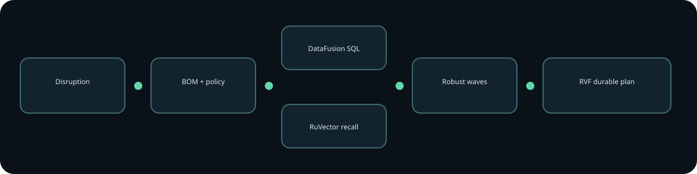
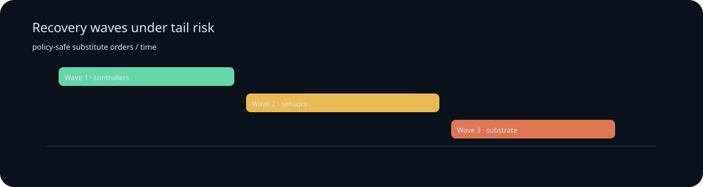

# Supply Weave

**A procurement resilience workstation that turns multi-tier disruption into policy-safe recovery waves with durable evidence.**



Supply Weave is not a spreadsheet, validator or generic dashboard. A planner models a supplier outage; the Rust service propagates demand through the BOM, protects safety stock, executes Apache DataFusion SQL, recalls analogous plans through RuVector, ranks substitutes with CVaR-aware robust allocation, enforces certification/concentration, appends the plan to RVF and renders the result in React.

## Quickstart

```bash
cp .env.example .env
bash scripts/bootstrap.sh
bash scripts/start.sh
```

Open http://127.0.0.1:18080. Health is '/health'; readiness is '/ready'. No secret is required for the deterministic synthetic prototype.

## Product journeys
1. **Plan disruption:** adjust region, severity, duration, demand, spend and concentration. Generate real coverage, shortage, cost, CVaR, supplier waves, BOM tiers and audit events.
2. **Deny and recover:** set concentration to 10%; policy denies and RVF count stays unchanged. Correct to a viable value and recompute.
3. **Retrieve durably:** open Audit, refresh or restart, and reopen the RVF-backed plan.

## Executed composition
|Ingredient|Responsibility|Removal signal|
|---|---|---|
|RuVector Core 2.4.0|VectorDB analogue recall|lower stability/coverage|
|RVF Runtime 0.4.0|append/reopen plan audit|retrieval becomes zero|
|Apache DataFusion 55.2.0|Arrow-backed capacity SQL|scenario quality degrades|
|DRO + CVaR|tail-aware supplier choice|worst-tail loss increases|

## Workspace
Twenty-five meaningful crates cover shared contracts; network, BOM, inventory, forecast and scenario; DataFusion, RuVector and RVF; robust allocation, policy and waves; auth/middleware; orchestration, API and evaluation. The exact responsibility/caller/test map is in [architecture](docs/architecture.md).

## Verification
```bash
DREAM_MACHINE_EVIDENCE_DIR=/tmp/supply-weave-evidence bash scripts/verify-prototype.sh
```

The source-pinned recorder executes nine suites: strict Rust, frontend type/lint/unit/build, API, middleware, live integrations, benchmark, ablations, browser and Docker. It rejects dirty source, stale SHAs, skipped journeys, fake artifacts, missing logs and absent semantic review. CI uploads evidence named with the tested SHA.



## Maturity and limitations
This high-fidelity prototype uses synthetic supplier/BOM data. It does not place orders, modify supplier systems, claim globally optimal MILP results, prove production durability, or authorize cloud deployment/spend. Local Docker was unavailable, making hosted CI the decisive container gate. Production storage, IAM, secrets and live supplier connectors require separate authorization.

## Design and evidence
[Specification](docs/specification.md) · [Architecture](docs/architecture.md) · [Research](docs/research.md) · [Implementation contract](docs/implementation-contract.md) · [Acceptance](docs/prototype-acceptance.md) · [Traceability](docs/traceability.md) · [Core-memory map](docs/core-memory-guidance-map.md) · [ADRs](docs/adr/README.md) · [DDD](docs/ddd/README.md)

Licensed MIT OR Apache-2.0.
